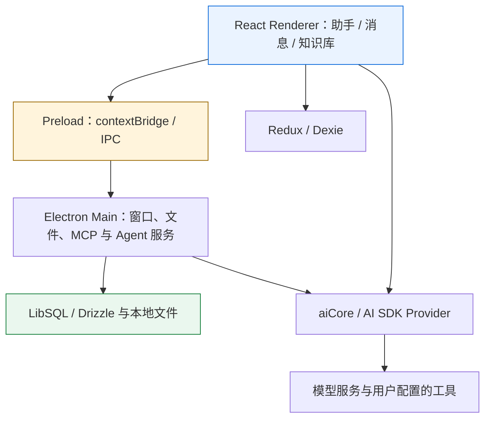

<p align="center"></p>
<h1 align="center">Cherry Studio · Windows</h1>
<p align="center">wed957 维护的 v1 衍生构建 · 多模型桌面工作台</p>
<p align="center">
  
  
  
  <a href="LICENSE"></a>
</p>
<p align="center">
  <a href="https://github.com/wed957/cherry-studio/releases/tag/windows-latest">Windows 下载</a> · <a href="#架构">架构</a> · <a href="#开发与构建">开发</a> · <a href="CUSTOM_BUILD.md">构建与同步详解</a> · <a href="AGENTS.md">Agent 约定</a>
</p>

---

基于 [CherryHQ/cherry-studio](https://github.com/CherryHQ/cherry-studio) 稳定 `v1` 分支的独立公开仓库，保留本地修复并维护 Windows 发行流程。当前应用版本字段为 `1.9.13`；这是社区衍生构建，不是 CherryHQ 官方发行，也不是 v2.x 实现。

| 工作场景 | 主要能力 |
| --- | --- |
| 多模型对话 | Provider、助手、话题、流式消息与模型参数 |
| 本地知识管理 | 文件、知识库、检索和笔记 |
| 工具与 Agent | MCP、工具调用、Agent 会话与本地服务 |
| 桌面集成 | Electron 主进程、受控 IPC、本地存储与 Windows 安装包 |

## 本仓库的维护重点

**上下文数量的真实语义。** 数字输入接受非负安全整数；`100` 是唯一的“全部消息”哨兵，`101`、`1000` 等值仍表示真实数量上限。滑块只钳制视觉显示，不覆盖已保存的大数值。

**可重复核对的补丁。** [context-count-patch.ts](scripts/context-count-patch.ts) 通过 TypeScript AST 验证可信控件和状态绑定，先检查全部目标再写入；未知结构、目标变化或 v2.x 源码树会停止处理。

**Windows 发布链。** 保留上游归属，针对 x64 / arm64 构建 portable 和 setup；通过精确提交、产物清单、SHA-256 和 Release 身份核对保持可追溯性。上游同步分支 `upstream-v1` 用于记录同步位置。

模型调用、搜索与用户启用的外部工具仍会访问相应服务。产品遥测与显式启用的开发追踪是不同边界，不能把本地存储描述为应用完全离线。

## 架构



| 层 | 当前技术 | 代码入口 |
| --- | --- | --- |
| 桌面运行时 | Electron `41.2.1` | [src/main/](src/main/) |
| 界面 | React `19`、TypeScript、Ant Design | [src/renderer/src/](src/renderer/src/) |
| 进程边界 | contextBridge、IPC | [src/preload/](src/preload/)、[packages/shared/](packages/shared/) |
| 状态与数据 | Redux Toolkit、Dexie、Drizzle / LibSQL | renderer 数据库与 main 服务 |
| 模型适配 | Vercel AI SDK `6`、aiCore | [packages/aiCore/](packages/aiCore/)、[packages/ai-sdk-provider/](packages/ai-sdk-provider/) |
| 构建与测试 | electron-vite、electron-builder、Vitest、Playwright | [package.json](package.json)、[工作流](.github/workflows/) |

版本要求以 `package.json`、锁文件和 `.node-version` 为准；旧版上游文档中的 Electron 38 / AI SDK 5 不适用于当前依赖树。

## 下载与发行

日常下载使用 [windows-latest](https://github.com/wed957/cherry-studio/releases/tag/windows-latest)。核对来源或排查滚动发布中断时，使用同一提交对应的 `windows-<完整 SHA>` 不可变 Release 和 `SHA256SUMS.txt`。

| 标识 | 用途 |
| --- | --- |
| `windows-<完整 SHA>` | 权威构建与固定审计记录 |
| `windows-latest` | 方便下载的滚动入口 |
| `upstream-v1` | 最近一次同步的上游提交 |
| `automation/upstream-candidate-*` | 待测试和发布的候选分支 |

自动同步先准备候选并执行补丁契约，完成测试、构建和不可变发布验证后再晋级分支，最后刷新滚动入口。滚动 Release 的 tag、元数据和全部资产无法由 GitHub 原子更新；更新中断时以已验证的不可变 Release 为准，恢复流程见 [CUSTOM_BUILD.md](CUSTOM_BUILD.md)。

推送 `main` 会触发现有 Windows 构建流程。Linux / macOS 脚本仍来自上游源码，本仓库的发行维护范围是 Windows。

## 开发与构建

需要 **Node.js 24.11.1+、pnpm 10.27.0**。Windows 安装包需要 Windows 构建环境；运行项目命令前完成依赖安装：

```powershell
git clone https://github.com/wed957/cherry-studio.git
cd cherry-studio
corepack enable
corepack pnpm install --frozen-lockfile
corepack pnpm dev
```

本地上下文补丁核对：

```powershell
corepack pnpm context-count:check
corepack pnpm exec vitest run scripts/context-count-patch.test.ts --silent
```

`context-count:apply` 会写源码；只有确实需要重应用补丁时才执行。同步与发布逻辑的完整验证命令见 [CUSTOM_BUILD.md](CUSTOM_BUILD.md)。

```powershell
corepack pnpm ci:basic-check
corepack pnpm test
corepack pnpm build:win
```

这些是开发验证入口，不表示本次文档提交已执行全量构建。`pnpm lint` 和 `pnpm format` 包含写入行为，运行后要复核差异。

## 维护与 Agent 接手

1. 先读 [AGENTS.md](AGENTS.md) 和 [CUSTOM_BUILD.md](CUSTOM_BUILD.md)，确认目标是本仓库 v1 衍生线。
2. 功能改动按 renderer、preload、main、aiCore 定位；跨进程接口同步检查共享类型与调用方。
3. 上下文数量改动同时检查 [contextCount.ts](src/renderer/src/utils/contextCount.ts)、[相关测试](src/renderer/src/utils/__tests__/contextCount.test.ts) 和 AST 补丁契约。
4. 同步与发布改动同时检查 [sync-upstream.yml](.github/workflows/sync-upstream.yml) 和 [build-windows.yml](.github/workflows/build-windows.yml)，保留候选事务、固定 SHA、权限和产物校验。
5. 提交使用 Conventional Commits，并带 `git commit --signoff`；验证结果写明具体提交与范围。

上游功能文档可从 [中文文档](docs/zh/README.md) 和 [开发指南](docs/en/guides/development.md) 继续阅读，其中涉及发行和本地补丁的内容以本仓库说明为准。

<a id="-community"></a>

## 问题与交流

本构建的上下文补丁、同步与 Windows 发布问题可提交到 [本仓库 Issues](https://github.com/wed957/cherry-studio/issues)，附版本、提交和脱敏后的复现步骤。通用产品讨论与上游社区入口见 [CherryHQ 项目](https://github.com/CherryHQ/cherry-studio)。

## 许可与致谢

源码沿用 [AGPL-3.0](LICENSE)。分发修改后的软件应保留版权、许可与对应源码；通过网络提供修改版本的服务时也应遵守适用条款。独立仓库身份不改变上游归属，也不代表获得 Cherry Studio 商标或外部服务的额外授权。

感谢 [CherryHQ](https://github.com/CherryHQ/cherry-studio) 及其贡献者。
